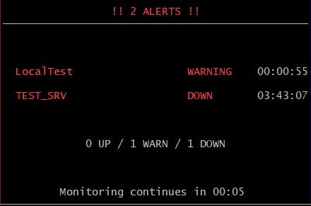
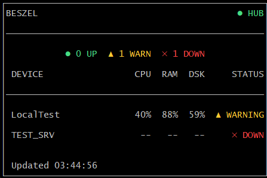
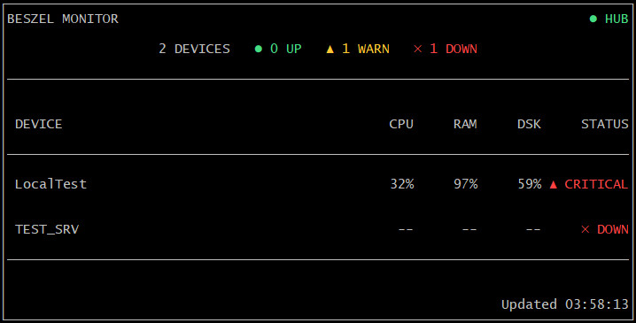
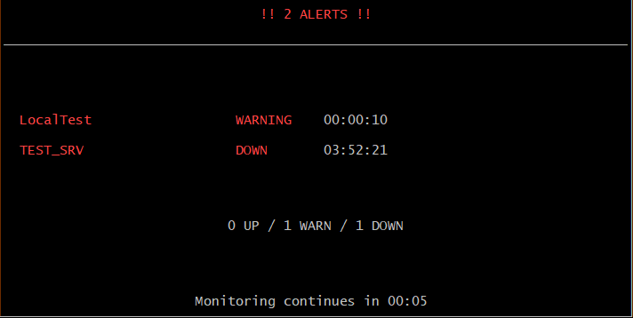

# Beszel View

[English](README.md) | [한국어](README.ko.md)

An unofficial CLI/TUI client for [Beszel](https://github.com/henrygd/beszel) that monitors multiple servers from a Beszel Hub.

<p align="center">
  
</p>

- Rotating overview, device detail, and alert screens
- View CPU, memory, and disk usage for every device
- Single-page mode for viewing all devices at once

## Quick start

Copy the example configuration and enter your Hub URL and credentials:

```bash
cp config.example.json config.json
```

Linux:

```bash
chmod +x beszelview
./beszelview --config config.json
```

Windows:

```powershell
Copy-Item config.example.json config.json
.\beszelview.exe --config config.json
```

Install with Go:

```bash
go install github.com/1325ok/Beszel-View-TUI/cmd/beszelview@latest
```

## Layouts and viewport size

| Layout | Use case | Minimum size |
|---|---|---:|
| `small` | Small LCDs and essential metrics | `38x13` |
| `large` | Monitoring dashboard with tables and graphs | `80x22` |
| `auto` | Uses large at `100x30` or above, otherwise small | `38x13` |

```bash
beszelview --config config.json --layout small --size 50x16
beszelview --config config.json --layout large --size 80x22
beszelview --config config.json --layout auto --size auto
```

## Preview

### Small layout

| Single-page mode | Standard rotating mode |
|:---:|:---:|
|  |  |

### Large layout

| Single-page mode | Standard rotating mode |
|:---:|:---:|
|  |  |

## Single-page mode

Show device status on one page without screen rotation:

```bash
beszelview --config config.json --single --size 80x24
```

You can also set `"single_mode": true` in `config.json` or use `BESZEL_SINGLE=true`. If every device cannot fit, the screen displays `+N MORE`; increase the viewport height to show more rows.

> Rotating/paginated list support is planned.

## Main options

| Option | Default | Description |
|---|---:|---|
| `--layout` | `auto` | `small`, `large`, or `auto` |
| `--size` | `auto` | Terminal size such as `80x22` |
| `--single` | `false` | Enable single-page mode |
| `--refresh` | `3s` | API refresh interval |
| `--rotation` | `5s` | Screen rotation interval |
| `--alert-duration` | `20s` | Alert screen duration |
| `--alert-blink` | `750ms` | Alert blink interval |

Run `beszelview --help` to see every option.

## Environment variables

```text
BESZEL_HUB_URL
BESZEL_EMAIL
BESZEL_PASSWORD
BESZEL_TOKEN
BESZEL_LAYOUT
BESZEL_SIZE
BESZEL_SINGLE
BESZEL_REFRESH
BESZEL_ROTATION
BESZEL_ALERT_DURATION
BESZEL_ALERT_BLINK
BESZEL_INSECURE_TLS
```

CLI options override environment variables, which override `config.json`.

## Build

```bash
go test ./...
go vet ./...
go build -o beszelview ./cmd/beszelview
```


## License

MIT License. See [LICENSE](LICENSE).
